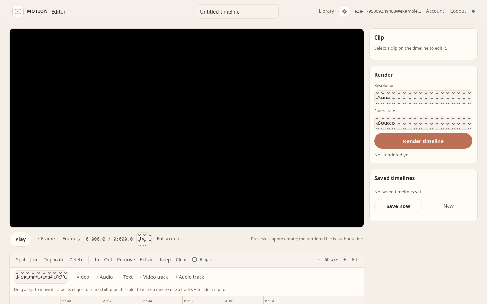
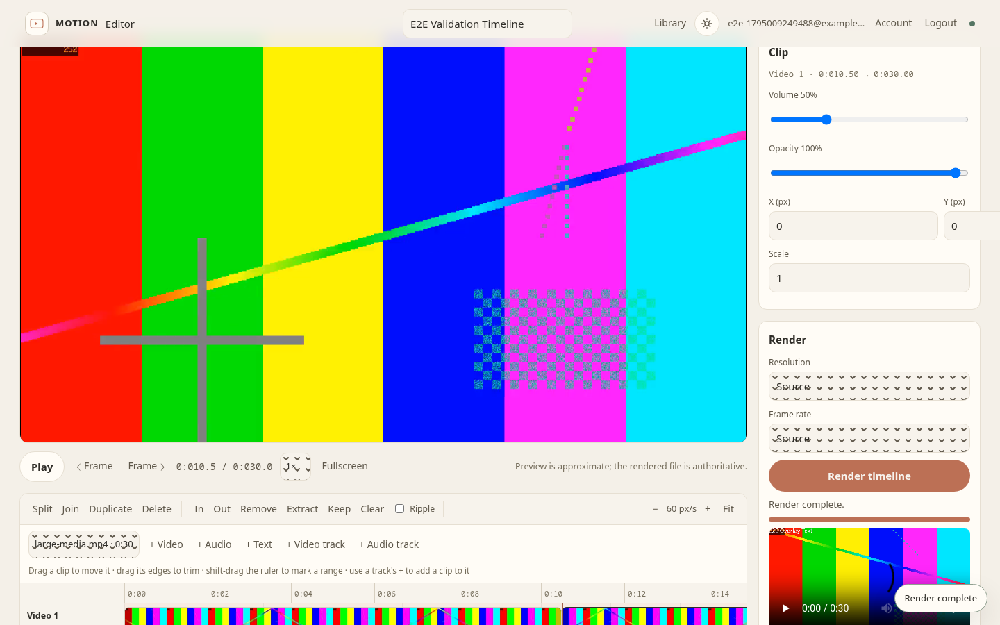

# Motion

Motion is a self-hosted web application for uploading, editing and processing videos.
You upload a clip through the browser, arrange it on a multi-track timeline (video, audio
and text overlays), render the result on the server with FFmpeg, and download the finished
video. It was built as a personal project to learn full-stack development — a Java backend
with a plain JavaScript frontend and a SQLite database.

An earlier version of the backend was written in Go; that code is kept in the repository
under `internal/` and `main.go` for reference, but the Java application in `backend-java/`
is the current implementation.

## Features

- User registration, login and sessions (bcrypt password hashing, CSRF protection)
- Upload videos (MP4/MOV/MKV/WebM and friends, up to 150 MB) with validation and metadata probing
- Quick edits on a clip: trim, split, speed, flip, volume, audio extract
- Multi-track timeline editor in the browser: video and audio tracks, text overlays,
  clip trimming/splitting, per-clip volume, playhead preview
- Asynchronous rendering jobs with progress, cancellation and recovery after a crash
- Thumbnail filmstrips and audio waveforms in the editor
- Optional AES-256-GCM encryption of stored media
- Docker deployment with persistent volumes

## Tech stack

- Java 21, Spring Boot
- SQLite (WAL) with Flyway migrations
- FFmpeg / FFprobe (invoked from the application, no shell)
- HTML, CSS and vanilla JavaScript frontend (no build step)
- Docker (multi-stage image, runs as a non-root user)

## Running locally (without Docker)

Requires Java 21 (`java -version` must print 21) and FFmpeg + FFprobe on your PATH.

```bash
git clone <repository-url> motion
cd motion/backend-java
./mvnw -DskipTests package
cd ..
java -jar backend-java/target/motion-java-0.1.0-PHASE4.jar
```

Open http://localhost:8080, register an account and upload a video.
The storage directories `./data`, `./uploads` and `./outputs` are created
automatically on the first run (all git-ignored). Note: the app always starts
with a fresh database — it does not migrate data from the old Go version, so if
this checkout previously ran the Go app, move its old `data/`, `uploads/` and
`outputs/` out of the way first.
The application logs to the console; stop it with Ctrl+C.

Without `MOTION_ENCRYPTION_KEY` set, media is stored unencrypted, which is fine
for local development.

## Deployment with Docker Compose

The Compose file is written for a server where a reverse proxy (e.g. Caddy or nginx)
reaches Motion over a shared Docker network, so the container does not publish a port
on the host by default.

```bash
# one-time: the network Motion shares with the proxy
docker network create homelab

# configure
cp backend-java/.env.example .env
# edit .env — at minimum set:
#   BASE_URL=https://your-domain.example
#   MOTION_ENCRYPTION_KEY=<see below>
#   TRUSTED_ORIGINS / TRUSTED_PROXIES if you run behind a proxy

# build and start
docker compose -f docker-compose.java.yml --profile java up -d --build

# check it is healthy, then open the site through your proxy
docker compose -f docker-compose.java.yml ps
docker exec motion-java curl -s http://localhost:8080/health

# logs / stop (never use "down -v", it deletes the data volumes)
docker compose -f docker-compose.java.yml logs -f motion-java
docker compose -f docker-compose.java.yml --profile java down
```

FFmpeg and FFprobe are installed inside the Docker image, so nothing extra is needed there.
The application stores its database and media in three named volumes
(`motion_java_data`, `motion_java_uploads`, `motion_java_outputs`), which persist across
restarts and upgrades.

### Encryption key

Generate a key before your first real upload:

```bash
openssl rand -base64 32
```

Put the output in `MOTION_ENCRYPTION_KEY` in your `.env` file and **keep a copy somewhere
safe** — all uploaded media is encrypted with it, and if the key is lost the media cannot
be recovered. There is no key-rotation tooling. The `.env` file also holds your SMTP
settings (if you want password-reset emails) and is already excluded by `.gitignore`;
never commit it.

More details: configuration reference and deployment/backup instructions live in
[`backend-java/docs/`](backend-java/docs/) (`CONFIGURATION.md`, `DEPLOYMENT.md`,
`SECURITY.md`, `TROUBLESHOOTING.md`). For deploying on a home server behind
Caddy/Cloudflare (including private testing, backups and a cutover checklist),
follow the step-by-step [HOME_SERVER_DEPLOYMENT_GUIDE.md](HOME_SERVER_DEPLOYMENT_GUIDE.md).

## Screenshots





## Notes

- Single-instance application: run one container per database; the job queue is not
  designed for multiple instances.
- `docs/API.md`, `docs/ARCHITECTURE.md` and `docs/DEVELOPMENT.md` describe the older Go
  version. The Java application is documented in `backend-java/docs/`.

## License

No license has been chosen yet — all rights reserved for now.
