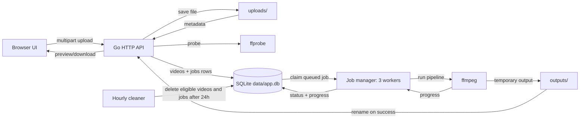

# Motion

Motion is a local, self-hosted video processing web application written in Go. It lets a user upload a video, build a short FFmpeg processing pipeline, run it as a persistent background job, follow progress, cancel work, and preview or download the result.

The project is aimed at developers and hobbyists who want a small, readable example of combining Go, SQLite, FFmpeg, background workers, and a vanilla JavaScript frontend. It supports multi-user authentication with per-user ownership; treat it as a self-hostable tool and review the security notes before exposing beyond trusted networks.

> `ProjectSpec.md` contains early design notes and aspirational ideas. This README documents the current implementation.

## Features

### Backend

- Video upload through `multipart/form-data` with extension, size, duration, resolution, and media probing checks.
- Persistent video metadata and job history in SQLite.
- A bounded job queue with three workers, claimed atomically from the database.
- Five processing operations: trim, speed, volume, flip, and extract audio.
- Chained operations executed as one FFmpeg pipeline.
- Job statuses persisted through `queued`, `processing`, `cancel_requested`, `completed`, `failed`, and `cancelled`.
- Progress reporting parsed from FFmpeg's `-progress pipe:1` output.
- Cancellation of queued jobs and interruption of running FFmpeg jobs.
- Recovery of jobs interrupted by a crash or graceful restart.
- Hourly cleanup of terminal videos and their job history once the video and all jobs are at least 24 hours old.
- CORS middleware and an optional static frontend served from `./web`.

### Frontend

- Drag-and-drop and file-picker upload with browser-side type and size checks.
- Library/video selector with status and metadata.
- Video/audio preview with switches between the original and processed output.
- Tool-based editor to add/reorder/remove operations with inline configuration and validation.
- Process/Export panel with progress, error details, cancellation, output preview, and download.
- Job history with preview/download/cancel actions.
- Polling while a job is active.
- Theme toggle (light/dark/system) with persistence.

### Upload limits and formats

| Constraint | Value | Enforced by |
| --- | --- | --- |
| Maximum upload size | 150 MiB (`150 << 20` bytes) | HTTP body limit and `FileHeader.Size` check |
| Maximum duration | 300 seconds | FFprobe metadata after upload |
| Maximum resolution | width ≤ 1920 and height ≤ 1080 | FFprobe metadata after upload |
| Required stream | A video stream must be present | FFprobe metadata after upload |
| Supported extensions | `.mp4`, `.m4v`, `.mov`, `.mkv`, `.webm`, `.avi`, `.mpeg`, `.mpg`, `.3gp` | Extension allowlist |

The extension check is not a codec guarantee. Files are also probed with FFprobe, and corrupt or non-media files are rejected. Because the 150 MiB limit applies to the whole multipart request, a file very close to 150 MiB can fail due to multipart overhead. Audio-only uploads are currently rejected by the video-stream check. Video-only uploads are accepted; `trim`, `speed`, and `flip` work without audio, while `volume` and `to_audio` fail with an explicit missing-audio job error. Invalid media and other client mistakes return `400`; storage, probing-infrastructure, and database failures return `500`.

### Implemented security & ops features

- User registration/login, password hashing (bcrypt), session-based auth with idle/absolute TTLs, session rotation/revocation.
- Per-user ownership enforced on videos/jobs with CSRF protection for cookie-authenticated state changes.
- Rate limiting on login/register/password-reset endpoints; trusted-origin CORS with credentials only for trusted origins.
- Environment-based configuration via `internal/config` (see Configuration).
- Dockerfile, docker-compose, and healthchecks included.

### Not implemented

The current code does **not** include API keys, cloud/object storage, signed upload URLs, broad per-IP active-job quotas beyond basic rate limits, GIF export, rotation, crop, resize, general format conversion (beyond MP4/MP3 for current operations), subtitle handling, video merging, a `DELETE` endpoint, or WebSocket/SSE progress (polling is used).

## Screenshots

No screenshots are committed to this repository yet. To add them, create image files under `docs/screenshots/` and replace this paragraph with Markdown image links such as:

```markdown

```

Suggested captures are the library and upload area, an active pipeline with progress, and a completed output. Do not use generated or mocked screenshots as documentation of real behavior.

## Tech stack

| Layer | Technology | Role |
| --- | --- | --- |
| Language | Go 1.26.2 (declared in `go.mod`) | HTTP server, services, workers, database access |
| HTTP | Standard library `net/http` with Go 1.22+ method/path patterns | Routing, multipart uploads, file serving |
| Database | SQLite via `modernc.org/sqlite` v1.50.0 | Persistent videos, jobs, and migrations; pure Go driver, no CGO |
| Media | FFmpeg and FFprobe executables, wrapped by `github.com/u2takey/ffmpeg-go` v0.5.0 | Probing and processing |
| IDs | `github.com/google/uuid` v1.6.0 | Video and job identifiers |
| Frontend | HTML, CSS, vanilla JavaScript | Static UI served by the Go server; no Node.js build step |

FFmpeg and FFprobe are external runtime dependencies. They are not embedded in the application.

## Architecture

The application starts one HTTP server and one job manager. The request path is:

1. The browser uploads a file to `POST /upload`.
2. The server enforces the request-size limit, validates the extension, saves the file under `uploads/`, runs FFprobe, and applies duration/resolution/stream checks.
3. A `videos` row is created with status `uploaded`.
4. The user submits operations to `POST /videos/{id}/process`.
5. The server validates the operations and creates a persistent `jobs` row with status `queued`; the video is also marked `queued`.
6. A worker atomically claims the oldest queued job and marks it `processing`.
7. The worker executes the operations with FFmpeg, writing to a temporary file under `outputs/`.
8. FFmpeg progress is parsed and written to both the job and video rows.
9. On success, the temporary file is renamed to `outputs/<job-id>.mp4` (or `.mp3`), and job/video status becomes `completed`.
10. The output can be previewed or downloaded through video-level or job-level routes.
11. Cleanup and restart recovery handle terminal and interrupted jobs as described below.



For package-level details, concurrency behavior, and lifecycle transitions, see [docs/ARCHITECTURE.md](docs/ARCHITECTURE.md).

## Project structure

```text
.
├── main.go                     # startup, directories, server, workers, shutdown
├── go.mod / go.sum             # Go module dependencies
├── README.md                   # this document
├── ProjectSpec.md              # historical/aspirational design notes
├── internal/
│   ├── api/                    # router, handlers, CORS, JSON responses, API tests
│   ├── db/                     # SQLite setup, migrations, video/job stores
│   ├── ffmpeg/                 # FFmpeg pipeline builder and progress parser
│   ├── job/                    # manager, workers, recovery, cleanup
│   ├── logger/                 # stdout/stderr loggers
│   ├── media/                  # FFprobe JSON metadata extraction
│   ├── models/                 # Video, Job, Operation, statuses
│   ├── service/                # upload service and processing pipeline
│   └── validation/             # operation validation rules
├── web/                        # static frontend (index.html, app.js, styles.css)
├── docs/
│   ├── API.md                  # complete endpoint reference
│   ├── ARCHITECTURE.md         # package responsibilities and job lifecycle
│   ├── DEVELOPMENT.md          # setup, testing, troubleshooting
│   └── screenshots/            # screenshot placeholder (no images yet)
├── uploads/                    # runtime uploads (created automatically)
├── outputs/                    # runtime outputs (created automatically)
└── data/                       # SQLite database (created automatically)
```

`uploads/`, `outputs/`, and `data/` are created on startup if missing. `.gitignore` covers `*.db*`, `*.mp4`, and `*.mp3`, but not every accepted upload format (for example `.mov`, `.mkv`, or `.webm`). Do not commit runtime media or databases.

## Prerequisites

- **Go 1.26.2 or a compatible newer toolchain** as declared in `go.mod`.
- **FFmpeg and FFprobe** available on `PATH`. Both commands are required for upload probing and processing.
- A browser for the frontend.
- Enough disk space for uploads, outputs, and the SQLite database.

No Node.js, npm, external SQLite server, or C compiler is required by this project.

Verify the tools:

```bash
go version
ffmpeg -version
ffprobe -version
```

## Installation and local development

Clone the repository (replace `<repository-url>` with your remote):

```bash
git clone <repository-url> Motion
cd Motion
```

Install Go dependencies:

```bash
go mod download
```

Install FFmpeg if needed:

```bash
# Debian / Ubuntu
sudo apt update && sudo apt install ffmpeg

# Fedora
sudo dnf install ffmpeg

# Arch Linux
sudo pacman -S ffmpeg

# macOS (Homebrew)
brew install ffmpeg

# Windows (PowerShell; ensure the installed binary is on PATH)
winget install Gyan.FFmpeg
```

Start the application from the repository root:

```bash
go run .
```

The server creates `uploads/`, `outputs/`, and `data/`, opens `data/app.db`, starts three workers, and listens on port `8080`. Open:

```text
http://localhost:8080
```

Optional standalone build:

```bash
go build -o motion .
./motion
```

Run the test suite:

```bash
go test ./...
```

Some API integration tests generate videos with FFmpeg and are skipped when `ffmpeg` or `ffprobe` is unavailable. See [docs/DEVELOPMENT.md](docs/DEVELOPMENT.md) for test details, manual smoke tests, and troubleshooting.

## Configuration

Configuration is via environment variables (loaded by `internal/config`). See `.env.example` for defaults. Values can also be passed in Docker via environment or `.env`.

| Setting | Default | Env var | Notes |
| --- | --- | --- | --- |
| HTTP listen address/port | `:8080` | `PORT` | `main.go` normalizes `PORT` (adds `:` if missing). Binds to all interfaces. |
| Static frontend directory | `./web` | — | Set via `api.NewRouter`. |
| Database path | `data/app.db` | — | `main.go:27` |
| Runtime directories | `uploads/`, `outputs/`, `data/` | — | Created on startup. |
| Worker count | `3` | — | `main.go:35` |
| Session TTL | `24h` | `SESSION_TTL` | `internal/config` |
| Session idle TTL | `2h` | `SESSION_IDLE_TTL` | `internal/config` |
| Secure cookies | auto (true if `APP_ENV=production`) | `SECURE_COOKIES` | Also set in Docker. |
| Trusted origins (CORS) | empty (same-origin/non-browser allowed; untrusted origins restricted) | `TRUSTED_ORIGINS` | Comma-separated origins. |
| Rate limits | login 10/min, register 5/min, reset 3/hour | `RATE_LIMIT_LOGIN`, `RATE_LIMIT_REGISTER`, `RATE_LIMIT_RESET` | `internal/rate` |
| SMTP (password reset) | disabled (DevNull) | `SMTP_HOST`, `SMTP_PORT`, `SMTP_USER`, `SMTP_PASS`, `SMTP_FROM` | If unset, reset emails are not sent (tokens still generated internally). |
| Base URL | `http://localhost:8080` | `BASE_URL` | Used in reset emails. |
| Upload body limit | 150 MiB | — | `internal/api/handlers.go` |
| Process request body limit | 1 MiB | — | `internal/api/handlers.go` |
| Maximum duration | 300 seconds | — | `internal/service/process.go` |
| Maximum width/height | 1920 / 1080 | — | `internal/service/process.go` |
| Maximum operations | 10 | — | `internal/validation/validate.go` |
| Speed range | 0.5–2.0 inclusive | — | `internal/validation/validate.go` |
| Cleanup interval | 1 hour | — | `internal/job/cleanup.go` |
| Retention age | Video and every associated job must be at least 24 hours old | — | `internal/job/cleanup.go` |
| CORS policy | Restricted by trusted origins (credentials allowed only for trusted origins) | — | `internal/api/middleware.go` |

The listen address binds to all network interfaces, not only loopback. Authentication is enabled by default with session-based auth, CSRF protection, and per-user ownership; see [Security and limitations](#security-and-limitations).

## Usage guide

1. Open `http://localhost:8080`. The top bar shows backend status and a **Refresh library** button.
2. Upload a file by dragging it onto the left drop zone or using **Browse files**. The browser checks the extension and 150 MiB limit before uploading; the server repeats validation.
3. Select the uploaded video in the **Library**. The workspace shows metadata and the original video.
4. In **Edit video**, choose an operation, fill in its fields, and click **Add operation**. The pipeline runs top to bottom.
5. Use the up/down buttons to reorder operations or the remove button to delete one. The UI validates the pipeline and explains errors.
6. Click **Process video** (or **Process again** after a completed attempt). The job is queued and the pipeline is locked while it is active.
7. Follow progress in the library item and the **Process** panel. The frontend polls while the status is `queued`, `processing`, or `cancel_requested`.
8. While a job is queued or processing, click **Cancel job** (or the cancel action in job history). The worker discards partial output.
9. When the job completes, use **Preview output** or **Download MP4/MP3**. The **Original** switch remains available.
10. Job history lists earlier attempts for the selected video. Completed attempts can still be previewed or downloaded individually.

The UI labels the `uploaded` status as **Ready**. Completed outputs are `.mp4` unless the pipeline ends in **Extract audio**, in which case the output is `.mp3`.

## Supported processing operations

Operations are applied in the order submitted, as one FFmpeg pipeline. A request may contain at most 10 operations.

| Operation | What it does | Parameters | Validation and defaults | FFmpeg behavior |
| --- | --- | --- | --- | --- |
| `trim` | Keeps a time range and resets timestamps | `start`, `end` strings | Both required. Accepts seconds (`12`), `MM:SS`, or `HH:MM:SS`, with fractional seconds. `start < end`; `end ≤ duration + 0.001` when duration is known. | `trim`/`atrim` plus `setpts=PTS-STARTPTS` / `asetpts=PTS-STARTPTS` |
| `speed` | Changes playback speed | `factor` number | Required; 0.5 ≤ factor ≤ 2.0; NaN/Inf rejected. UI defaults to `1`. | Video `setpts=(1/factor)*PTS`, audio `atempo=factor`, `fps_mode=passthrough` |
| `volume` | Changes the audio volume inside the file | `factor` number | Required; must be > 0; NaN/Inf rejected. No upper bound in backend validation. UI defaults to `1`. | Audio `volume=factor` |
| `flip` | Mirrors the image | `orientation` number | Required in practice: `0` = vertical (upside down), `1` = horizontal (left/right mirror). UI defaults to `0`. | `vflip` for `0`, `hflip` for `1` |
| `to_audio` | Extracts audio as MP3 | none | Allowed once and must be the last operation. Requires an audio track. | Disables video, uses `libmp3lame`, `q:a=2`, output `.mp3` |

Additional behavior and constraints:

- `trim` uses the current stream state. Multiple trims are not explicitly forbidden.
- `to_audio` must be last because later video operations would be silently discarded; the validator rejects that ordering.
- `flip` before `to_audio` is accepted but has no effect on the audio-only output; the frontend displays a warning.
- The source is probed once before the pipeline. `trim`, `speed`, and `flip` work for video-only sources because audio is mapped only when present. `volume` and `to_audio` require audio and fail early with an explicit job error when it is missing. Volume factors must be finite and greater than zero at both the API and service layers; zero is not treated as mute.
- The output container is `.mp4` for all non-audio pipelines and `.mp3` for `to_audio`. This is not a general format-conversion feature.
- Unmodified video/audio streams may be stream-copied into the `.mp4` output, so compatibility depends on the source codecs. For example, a codec that cannot be placed in MP4 may make the job fail.
- Progress is computed from FFmpeg's `out_time_ms` against the **source** duration. Trimmed or sped-up outputs may therefore show inaccurate intermediate progress; completion is explicitly set to 100.

See the validation code in `internal/validation/validate.go` and the pipeline code in `internal/ffmpeg/ffmpeg.go` and `internal/service/process.go`.

## API reference

All API errors use JSON with this shape:

```json
{"error":"human-readable message"}
```

Routes are method-specific. Unsupported methods return `405 Method Not Allowed` from the Go router (plain text, not JSON). `OPTIONS` requests return `200 OK` because of the CORS middleware.

| Method | Path | Purpose |
| --- | --- | --- |
| `GET` | `/health` | Health check |
| `POST` | `/upload` | Upload a video (`multipart/form-data`, field `video`) |
| `GET` | `/videos` | List videos, newest first |
| `GET` | `/videos/{id}` | Get one video's public metadata |
| `GET` | `/videos/{id}/original` | Preview the original file inline |
| `GET` | `/videos/{id}/output` | Preview the latest completed output inline |
| `GET` | `/videos/{id}/download` | Download the latest completed output |
| `POST` | `/videos/{id}/process` | Validate operations and queue a job |
| `GET` | `/jobs` | List recent jobs, or one video's jobs with `?videoId=` |
| `GET` | `/jobs/{id}` | Get one job |
| `POST` | `/jobs/{id}/cancel` | Cancel a queued job or request cancellation of a running job |
| `GET` | `/jobs/{id}/output` | Preview a completed job's output inline |
| `GET` | `/jobs/{id}/download` | Download a completed job's output |

Quick examples (Bash):

```bash
# Health
curl -s http://localhost:8080/health

# Upload
curl -sS -F "video=@sample.mp4" http://localhost:8080/upload

# List videos
curl -s http://localhost:8080/videos

# Queue a processing job
curl -sS -X POST \
  -H "Content-Type: application/json" \
  -d '{"operations":[{"type":"trim","start":"00:00:00","end":"00:00:02"},{"type":"speed","factor":1.5}]}' \
  http://localhost:8080/videos/VIDEO_ID/process

# Check a job
curl -s http://localhost:8080/jobs/JOB_ID

# List jobs for one video
curl -s "http://localhost:8080/jobs?videoId=VIDEO_ID"

# Cancel a job
curl -sS -X POST http://localhost:8080/jobs/JOB_ID/cancel

# Preview/download a completed job output
curl -I http://localhost:8080/jobs/JOB_ID/output
curl -L -o edited.mp4 http://localhost:8080/jobs/JOB_ID/download
```

Response fields, status codes, request schemas, and more examples are documented in [docs/API.md](docs/API.md).

## Job lifecycle and persistence

### Statuses

| Status | Meaning |
| --- | --- |
| `uploaded` | Video-only status: the original is stored and ready for a pipeline |
| `queued` | A persistent job exists and is waiting for a worker |
| `processing` | A worker has claimed the job and FFmpeg is running |
| `cancel_requested` | Cancellation was requested for a running job; the worker is stopping it |
| `cancelled` | The job was cancelled; partial output is removed |
| `completed` | FFmpeg produced a non-empty output and the database was updated |
| `failed` | Processing or recovery failed; an error message is stored |

The `videos.status` field mirrors the latest job status; newly uploaded sources use `uploaded` before any job exists.

### Transitions

- Creating a job moves the video from any non-active state to `queued` and creates a job with `queued`.
- A queued job can be cancelled directly, moving to `cancelled`.
- A worker atomically claims the oldest queued job, moving it to `processing` and setting `started_at`.
- A processing job can finish as `completed`, fail as `failed`, move to `cancel_requested`, or be requeued after shutdown.
- `cancel_requested` becomes `cancelled` after the worker stops.
- Terminal states (`completed`, `failed`, `cancelled`) do not block a new attempt. Only queued, processing, and cancel-requested jobs are active, enforced by a partial unique index on `video_id`.
- Starting a new attempt clears the video's latest `output_path`, but earlier completed jobs keep their own outputs and remain available through job-level routes.

### Recovery and cleanup

On startup, before workers begin, the manager repairs jobs left in `processing` or `cancel_requested`:

- `cancel_requested` jobs are marked `cancelled`.
- `processing` jobs with missing source files or invalid saved operations are marked `failed`.
- Other `processing` jobs are requeued and retried.

Already-queued jobs remain queued and are picked up normally. On graceful shutdown, the HTTP server stops first, then the manager cancels its context; running jobs are interrupted and requeued (or cancelled if cancellation was requested).

A cleanup goroutine runs every hour and deletes terminal videos only when the video **and every associated job** are at least 24 hours old. The video must be `completed`, `failed`, or `cancelled`; every job must be terminal, its creation time must be old enough, and any finish time must also be old enough. Active jobs and recently created or finished jobs protect the whole video from cleanup. Uploaded, queued, processing, and cancel-requested videos are never expired.

Deletion is transactional: the cleanup query revalidates eligibility, deletes the video row and cascades its job rows together, and only then removes the original, latest output, and per-job artifacts. If the database deletion fails, rows and files are left intact for a later attempt. File removal is best effort after the database commit, so a filesystem error can leave an orphaned file but not a database row that points at a missing file. Job history is still retained only as long as its video.

For a deeper treatment, including race handling and shutdown behavior, see [docs/ARCHITECTURE.md](docs/ARCHITECTURE.md).

## Database and data storage

SQLite is opened at `data/app.db` with WAL mode, a 5-second busy timeout, and foreign keys enabled. The connection pool is limited to one connection. Migrations are tracked in `schema_migrations` and applied on startup.

### Tables

**`videos`** stores one row per uploaded source:

- `id` (UUID primary key), `original_path`, `original_name`, `file_size`
- `output_path`, `status`, `progress`, `operations`
- `duration`, `width`, `height`, `error`, `created_at`
- Index: `status`

**`jobs`** stores each processing attempt:

- `id` (UUID primary key), `video_id` (foreign key to `videos`), `video_name`, `source_path`
- `operations` (JSON snapshot), `status`, `progress`, `output_path`, `error`
- `created_at`, `started_at`, `finished_at`, `cancel_requested_at`
- Indexes: `status`, `video_id`, `created_at`
- Partial unique index: one active job (`queued`, `processing`, `cancel_requested`) per video
- Deleting a video cascades to its jobs

### Files

- Original uploads: `uploads/<video-id><lowercase-extension>`
- Completed outputs: `outputs/<job-id>.mp4` or `outputs/<job-id>.mp3`
- Temporary FFmpeg output: `outputs/.<job-id>.part.mp4` or `.part.mp3` (removed on failure/cancel/restart)

The database and filesystem are separate stores. Deleting rows does not automatically delete files; the cleanup goroutine performs both operations. Data survives restarts except for files removed by cleanup or external deletion.

### Backup advice

For a consistent backup, either stop the application and copy `data/app.db` (plus `data/app.db-wal` and `data/app.db-shm` if present) along with `uploads/` and `outputs/`, or use SQLite's online backup while the app is running:

```bash
sqlite3 data/app.db ".backup '/path/to/app-backup.db'"
```

Back up the media directories separately and together with the database so rows and files stay consistent. The SQLite CLI is optional for the application but useful for inspection and backups.

## Testing and troubleshooting

At the time of documentation, the following commands were run from the repository root with Go 1.27.3, FFmpeg/FFprobe n9.0.2, and Linux:

```bash
go test ./...   # all packages passed; integration packages that need FFmpeg ran
go vet ./...    # passed
gofmt -l $(git ls-files '*.go')  # no files reported
```

The API tests skip video-processing cases when FFmpeg/FFprobe are not installed. Unit tests for the database, job store, and validation do not need FFmpeg. See [docs/DEVELOPMENT.md](docs/DEVELOPMENT.md) for individual test commands.

Common issues:

- **FFmpeg/FFprobe not found**: uploads return `500` because probing infrastructure is unavailable, and processing fails. Check `command -v ffmpeg ffprobe` and ensure both are on the `PATH` used to start the server. The app does not validate tools at startup.
- **Upload rejected (400)**: check the extension, file corruption, duration (≤ 300 s), dimensions (width ≤ 1920 and height ≤ 1080), and whether a video stream exists. Inspect with `ffprobe sample.mp4`.
- **Upload rejected (413)**: the request exceeds 150 MiB, including multipart overhead.
- **Upload failed (500)**: the server could not save the file, run the media probe, or persist the database row. Check the server log for the underlying error; the HTTP response intentionally omits filesystem paths and internal details.
- **Processing failed**: read the job's `error` and the server logs. FFmpeg's compiled command and error output go to the server's stderr/stdout. Common causes are `volume` or `to_audio` on a source without audio, incompatible stream copy into MP4, or unsupported input codecs.
- **Job appears stuck**: queued jobs wait for a free worker. Only `processing` and `cancel_requested` jobs are repaired on restart; queued jobs stay queued until a worker claims them. There is no retry endpoint for a failed job; submit a new processing request.
- **SQLite permission or locking errors**: ensure the process can write `data/`, and avoid external writers holding long transactions. The app uses a single connection, WAL, and a 5-second busy timeout.
- **Missing output (404)**: the output may never have completed, may have been removed, or may have been cleaned up. Cleanup requires the video and all of its jobs to be at least 24 hours old and runs hourly.
- **Port conflict**: the port is hardcoded. Stop the process using port 8080 or change `Addr` in `main.go` and rebuild. On Linux, `ss -ltnp | grep 8080` helps identify the process.
- **Frontend loads but API calls fail**: start the server from the repository root so `./web` and the relative data directories resolve correctly. Check the browser console and the server log.
- **Job history does not load**: the frontend treats job history as supplemental. If `/jobs` fails, the library still renders without history and recovers on the next successful load.

For detailed troubleshooting and manual tests, see [docs/DEVELOPMENT.md](docs/DEVELOPMENT.md).

## Security and limitations

**This application has authentication, session management, CSRF protection, and per-user ownership, but it is not fully hardened for production use by default.**

- **Authentication/Authorization:** User registration/login, password hashing (bcrypt), session cookies (`HttpOnly`, `SameSite=Lax`), idle/absolute session TTLs, password change revokes other sessions, password reset via token (rate-limited). All video/job endpoints require authentication; resources are filtered by ownership.  
- **CSRF:** Double-submit CSRF protection is enforced for state-changing requests when using cookie-based auth (CSRF cookie + `X-CSRF-Token` header or `_csrf` form field).  
- **Network/CORS:** HTTP server binds to all interfaces by default. CORS is restricted by `TRUSTED_ORIGINS` (comma-separated); credentials are only allowed for trusted origins. Untrusted cross-origin requests without trust are handled strictly.  
- **Rate limiting:** In-memory rate limits on login/register/password-reset endpoints.  
- **Input validation & media safety:** Upload validation checks extension, size, and FFprobe metadata (duration/resolution/stream). FFmpeg processes untrusted media at the server privilege level with no sandbox, CPU/memory limit, or job timeout.  
- **File handling:** Uploaded files stored with generated UUID names under `uploads/`; original filenames sanitized via `filepath.Base` for display/headers. File-serving routes validate paths are within allowed directories (`uploads/`, `outputs/`), use paths from the database, and enforce ownership. API responses omit internal filesystem paths.  
- **Storage:** Database/media unencrypted on disk until deleted/cleaned up.  
- **Other:** No `DELETE` endpoint, limited audit logging, no malware scanning, no per-IP job quotas.  
- **TLS/Deployment:** No TLS in-app; use a reverse proxy and set `SECURE_COOKIES=true` in production.

**Recommendations before public exposure:** Bind to loopback/private interface or put behind auth proxy, restrict `TRUSTED_ORIGINS`, use HTTPS + secure cookies, enforce upload/processing quotas/timeouts, isolate FFmpeg (container/non-root with limits), add stronger rate limiting, consider malware scanning, and implement backup/retention policies.

No license file is included in this repository; do not assume a license for redistribution.

## Roadmap

These are potential improvements, **not implemented features**:

- A delete endpoint and configurable retention policy.
- Per-IP quotas and resource limits/timeouts for FFmpeg (sandboxing).
- More editing operations (rotate, resize, crop, format conversion, GIF, subtitles).
- Push-based progress (SSE/WebSocket) instead of polling.
- More accurate progress for trimmed and speed-adjusted outputs.
- Pagination and independent retention/cleanup for job history.
- Expanded automated tests for cancellation races and frontend behavior.
- API keys and alternate auth mechanisms.

## Documentation

- [API reference](docs/API.md)
- [Architecture and lifecycle](docs/ARCHITECTURE.md)
- [Development, testing, and troubleshooting](docs/DEVELOPMENT.md)
- [Screenshot placeholder](docs/screenshots/README.md)

## Docker Deployment

### Build and run with Docker Compose
```bash
docker compose up --build -d
```

### Volumes
- `motion_data` persists `data/` (SQLite database)
- `motion_uploads` persists `uploads/` (original files)
- `motion_outputs` persists `outputs/` (processed files)

### Configuration
Configure via environment variables in `docker-compose.yml` or `.env`. See `.env.example` for options. The container runs as non-root user `motion`, uses `ffmpeg` from the base image, and has a health check on `GET /health`.

### Reverse proxy & HTTPS
Run behind a reverse proxy and terminate TLS. Set `SECURE_COOKIES=true` in production when using HTTPS.

### Backup
Backup volumes: `motion_data`, `motion_uploads`, `motion_outputs`. For SQLite consistency, stop the app or use an online backup strategy.

### Upgrade
Pull new code, rebuild image, restart containers. Migrations run on startup.
