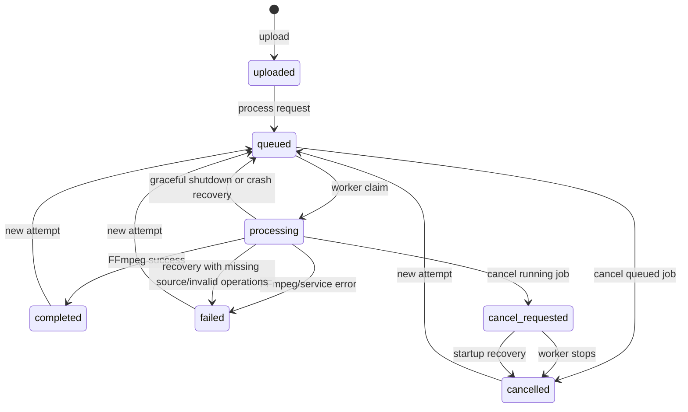

# Architecture and Lifecycle

This document describes the current implementation in the repository. It is intentionally more detailed than the root README.

> **Note:** the sections below focus on the original processing lifecycle, which is unchanged. Newer subsystems (storage/encryption, quotas, email verification, trusted-proxy rate limiting, and the additional editing operations) are summarized in [High-level components](#high-level-components) and the root [README](../README.md).

## High-level components

| Component | Package/File | Responsibility |
| --- | --- | --- |
| Entry point | `main.go` | Load config, build storage, run media-migration CLI, create directories, open the database, start workers, recover interrupted jobs, start cleaners, serve HTTP, shut down |
| Configuration | `internal/config` | Environment-driven settings, defaults, and validation |
| Storage | `internal/storage` | Owns upload/output/temp directories and the optional encryption facade |
| Encryption | `internal/mediacrypt` | AES-256-GCM chunked streaming and per-file key wrapping |
| Quotas | `internal/quota` | Active-upload reservations, stored-file/byte checks, and a free-disk guard |
| HTTP router | `internal/api/router.go` | Register method/path routes, wire middleware, serve static frontend |
| Handlers | `internal/api/handlers.go`, `editproject_handlers.go`, `verification_handlers.go`, `auth_handlers.go` | Upload, video/job reads, processing, cancellation, deletion, edit projects, auth, verification, file serving |
| Middleware | `internal/api/{middleware,auth_middleware,csrf}.go` | CORS, security headers, session auth, email-verification gate, CSRF |
| Response mapping | `internal/api/response.go` | Convert database models to path-free public JSON; clamp progress |
| Upload service | `internal/service/process.go` | Validate extension/size, save upload (encrypting if enabled), probe metadata, enforce limits, persist video |
| Processing service | `internal/service/process.go` | Build the FFmpeg pipeline, choose output type, run to a temporary file, verify/rename output |
| FFmpeg builder | `internal/ffmpeg/ffmpeg.go` | Compose filter streams, codec copy decisions, output context, progress wiring |
| FFprobe wrapper | `internal/ffmpeg/ffprobe.go` | Call `ffprobe` through `ffmpeg-go` |
| Progress parser | `internal/ffmpeg/progress.go` | Parse `out_time_ms=` lines from FFmpeg stdout |
| Metadata parser | `internal/media/metadata.go` | Extract duration, dimensions, codecs, frame rate, audio presence, format from FFprobe JSON |
| Validation | `internal/validation/validate.go` | Operation count/type/parameter/order rules; referenced-video ownership inputs |
| Models | `internal/models/video.go` | Video/Job/EditProject structs, operation request shape, status constants |
| Database setup | `internal/db/db.go` | SQLite pragmas, migration table, versioned migrations, legacy backfill |
| Video persistence | `internal/db/video.go` | Video CRUD, status/progress updates, encryption state, expiration query |
| Job persistence | `internal/db/job.go` | Job creation (quota-limited), claiming, progress, cancellation, terminal transitions, listing |
| Auth persistence | `internal/db/{user,session,reset,verification}.go` | Users, sessions, reset tokens, verification tokens |
| Edit projects | `internal/db/editproject.go` | Reusable edit-project CRUD |
| Job manager | `internal/job/queue.go` | Worker lifecycle, wake notifications, per-job cancellation map, artifact removal |
| Worker loop | `internal/job/worker.go` | Claim/run jobs, recover interrupted work, resolve cancellation/shutdown/error races, source resolver |
| Cleaner | `internal/job/cleanup.go` | Periodic deletion of old terminal videos, their jobs, and files |
| Rate limiting | `internal/rate` | In-memory limiters and trusted-proxy client IP resolution |
| Email | `internal/email` | SMTP sender and development outbox |
| Logger | `internal/logger/logger.go` | Informational stdout logger and error stderr logger |
| Frontend | `web/` | Static HTML/CSS/JS dashboard and advanced editor; polls the API |

## Startup sequence

1. `logger.Init()` initializes stdout/stderr loggers.
2. `config.Load()` reads and validates environment configuration.
3. `storage.New(cfg)` builds the storage manager (and validates the encryption key when set). `motion encrypt-media`/`decrypt-media` run here and exit.
4. `ensureDirectories()` creates the data directory and storage directories (upload/output/temp).
5. `db.Open("<data>/app.db")` opens SQLite, sets WAL journaling, a 5-second busy timeout, foreign keys on, and a single database connection.
6. Migrations are applied.
7. `VideoStore` and `JobStore` are constructed; `job.NewManager(jobStore, videoStore, storage, cfg.MaxGlobalConcurrentJobs)` creates a manager with the configured worker count.
8. `sweepTempFiles()` removes stale scratch files, then `manager.Recover()` repairs jobs left `processing` or `cancel_requested`.
9. A signal-aware context listens for `SIGINT` and `SIGTERM`.
10. `manager.Start(ctx)` launches workers; the cleanup and token-sweeper goroutines start.
11. `http.Server` listens on `:<PORT>` (default 8080), serves `./web`, and uses a 10-second header timeout.
12. On signal or server failure, HTTP shutdown is given 15 seconds, then `manager.Stop()` cancels workers and waits for them.

The cleaner is not tied to the shutdown context. The process exits after `main` returns, so this is not a long-running leak in normal operation.

## Upload flow

1. `POST /upload` wraps the body in `http.MaxBytesReader` at `MAX_UPLOAD_BYTES` and calls `ParseMultipartForm` with 32 MiB in-memory storage.
2. The handler requires the form field `video` and reserves a per-user active-upload slot, rejecting with `429` when the quota is exceeded.
3. `VideoService.Upload`:
   - Takes `filepath.Base` of the client filename.
   - Requires an extension and checks it against the allowlist.
   - Rejects files over `MAX_UPLOAD_BYTES`.
   - Generates a UUID and writes to a temp file, then `storage.StoreUpload` moves it to `uploads/<uuid><lowercase-ext>`, encrypting it when `MOTION_ENCRYPTION_KEY` is set.
   - Runs FFprobe and parses the JSON metadata.
   - Rejects duration > `MAX_DURATION_SECONDS`, width > `MAX_WIDTH`, or height > `MAX_HEIGHT`.
   - Requires a video stream (`meta.Width != 0`).
   - Inserts a `videos` row with status `uploaded`, progress 0, original path/name, bytes written, duration, width, height, and encryption state.
   - Removes the stored file if probing, validation, or persistence fails.
   - Classifies failures as client (`400`), quota (`429`), or internal (`500`).
4. The handler releases the upload slot and returns `201` with the path-free video response.

The upload is not transcoded. The stored original keeps its extension and original bytes.

## Processing request flow

1. `POST /videos/{id}/process` loads the video row (scoped to the authenticated user).
2. It verifies the original file still exists; otherwise it returns `409`.
3. It decodes a `ProcessRequest` from a body limited to 1 MiB.
4. `ValidateProcessRequest` enforces operation count, types, parameters, and ordering.
5. Any video referenced by an operation (`audioSourceId`, clip `videoId`) is checked for same-user ownership; otherwise the request is rejected.
6. The request is marshaled to JSON and passed to `JobStore.CreateQueuedLimited`, which enforces the per-user concurrent-job quota.
7. `CreateQueued` runs in a transaction:
   - Reads `original_path` and `original_name` from the video (snapshot into the job).
   - Counts active jobs for the video and rejects with `ErrActiveJob` if any exist.
   - Inserts a job with a new UUID, status `queued`, progress 0, and `created_at` from SQLite.
   - Updates the video to `queued`, stores operations, resets progress/error, and clears the latest `output_path`.
   - The partial unique index `idx_jobs_one_active_per_video` is a second guard against concurrent creation.
8. The handler calls `manager.Notify()` and returns `202` with the job. Exceeding the per-user job quota returns `429`.

## Worker claim and execution

Each worker loops:

1. Call `JobStore.ClaimNext()`.
2. If no queued job exists (`sql.ErrNoRows`), sleep up to 2 seconds or until `Notify()` wakes it.
3. On a claimed job, run it.
4. On database errors, log and sleep before retrying.

`ClaimNext` is one transaction:

- Finds the oldest queued job (`created_at ASC, id ASC`).
- Updates it to `processing`, resets progress, sets `started_at`, and clears `finished_at`, cancel timestamp, output path, and error.
- Uses `RETURNING` to read the claimed row.
- Updates the video to `processing` with the same operations and reset fields.
- Commits.

Because SQLite is configured with a single connection, workers serialize their database operations. Multiple workers can still run FFmpeg concurrently.

## Processing pipeline

`service.ProcessJob` receives the job, parsed operations, and a progress callback.

1. If any operation is `to_audio`, output is `.mp3` and type `audio`; otherwise output is `.mp4` and type `video`.
2. It checks the context and source file existence.
3. It probes the source once and parses its metadata. `to_audio` fails early when the source has no audio. `volume` also requires audio. Other operations proceed without an audio stream.
4. It creates an FFmpeg `Processor` with audio mapping enabled only when the source has audio, then applies operations in request order:
   - `trim` / `slice` — `trim`/`atrim` and timestamp resets.
   - `remove_section` — `select`/`aselect` (negated `between`) and timestamp resets.
   - `speed` — `setpts` on video and `atempo` on audio, with `fps_mode=passthrough`.
   - `volume` — validates a finite factor greater than zero, requires audio, then applies the `volume` filter.
   - `flip` — `vflip` or `hflip` on video only.
   - `add_audio` / `replace_audio` — adds the referenced owned video as a secondary input, trims/offsets it, and mixes (`amix`) or replaces the audio.
   - `to_audio` — drops video, forces MP3 (`libmp3lame`, `q:a=2`).
   - Unknown types are only logged here; validation should prevent them.
   - `concat` is handled separately (it must be the only operation): each clip is normalized to MPEG-TS (`scale`/`pad`/`setsar`/`fps`, with silent audio when absent) and joined with the concat demuxer, then remuxed.
5. If no operation was applied, it fails.
6. It creates `outputs/`, removes any existing temp/final file for the job, and runs FFmpeg to `outputs/.<job-id>.part.<ext>`.
7. FFmpeg is started with `-progress pipe:1` and `-nostats`. The source duration is probed first; if available, a goroutine parses progress lines. If not, stdout is drained to avoid blocking the process.
8. On FFmpeg error, the temp file is removed and a generic processing error is returned. The worker stores the error on the job/video.
9. After success, it checks the context again, verifies the temp file exists and is non-empty, then renames it to `outputs/<job-id>.<ext>`.
10. The worker reloads the job and resolves races before committing a terminal state.

### Codec-copy behavior

The processor tracks whether video and audio streams were modified. At output time:

- If video was not modified and no explicit video codec was set, `-c:v copy` is used.
- If audio was not modified and no explicit audio codec was set, `-c:a copy` is used.
- Modified streams are encoded by FFmpeg's defaults for the output container.
- `to_audio` forces an MP3 audio encode and disables video.

So the `.mp4` extension is not a guarantee that every stream was re-encoded. Source codecs that cannot be copied into MP4 can cause processing failures.

### Progress

`parseProgress` reads lines beginning with `out_time_ms=`. Despite the name, FFmpeg reports microseconds here; the code divides by 1,000,000 to get seconds, divides by the source duration, multiplies by 100, and clamps to 100.

`JobStore.UpdateProgress` only updates a job while it is `processing`, then mirrors the value into the video row in the same transaction. Completion explicitly sets job and video progress to 100. Failures and cancellations do not compute a final percentage.

Progress is based on the source duration, not the trimmed or speed-adjusted output duration, so intermediate values can be misleading for those pipelines. Progress writes occur for every parsed progress line, which can be frequent.

## Job and video state transitions



The `videos` row mirrors the latest job state. A new attempt clears the video's latest output path but does not delete earlier job outputs. The video-level output routes serve only the latest completed output; job-level routes serve each attempt's own output.

### Active-job constraint

The `jobs` table has a partial unique index:

```sql
CREATE UNIQUE INDEX idx_jobs_one_active_per_video
ON jobs(video_id)
WHERE status IN ('queued', 'processing', 'cancel_requested');
```

This prevents two active attempts for one video even if two requests race. Terminal jobs do not block a new attempt.

## Cancellation

`JobStore.RequestCancel` is a conditional update:

- `queued` → `cancelled`, sets `finished_at`, and clears error.
- `processing` → `cancel_requested`, sets `cancel_requested_at` and leaves `finished_at` unset.
- The video mirrors the corresponding status. Queued cancellation also resets video progress/output.

The manager's `Cancel` method calls `RequestCancel`, then, if the job was running:

- Looks up the per-job context cancel function.
- Calls it immediately if the worker has registered it.
- Otherwise records a pending cancellation so `registerCancel` can trigger it when the worker starts the job.

The worker registers its cancel function before processing and unregisters it afterward. The pending map closes the race where cancellation arrives between claim and registration.

If cancellation and completion race:

- `Complete` only transitions from `processing`. If cancellation wins, completion affects zero rows.
- The worker then removes artifacts and, if the job is `cancel_requested`, marks it `cancelled`.
- `Fail` is also conditional on `processing`, so a stale failure cannot overwrite a cancelled job.

Cancellation of an already terminal or already cancel-requested job returns `409`.

## Shutdown behavior

`main` stops accepting HTTP requests first (with a 15-second shutdown context), then calls `manager.Stop()`.

`manager.Stop()` cancels the manager context and waits for workers. FFmpeg receives the canceled context. After the processing call returns, the worker reloads the job:

- If status is `cancel_requested`, it removes artifacts and marks the job `cancelled`.
- If status is `cancelled`, it removes artifacts.
- If the manager context is canceled, it removes artifacts and requeues the job unless cancellation was requested.
- If processing failed, it removes artifacts and marks `failed`.
- Otherwise it attempts to complete.

This means work that finishes just as shutdown begins may be discarded and requeued rather than saved. That is intentional in the current implementation.

## Recovery

`Manager.Recover()` runs before workers start. It loads jobs in `processing` and `cancel_requested`:

- Removes known artifacts for every such job (`output_path`, standard `.mp4`/`.mp3` outputs, and `.part` files).
- `cancel_requested` jobs move to `cancelled`.
- Processing jobs with a missing source fail with `source file is no longer available`.
- Processing jobs whose saved operations are malformed or empty fail with `invalid saved operations`.
- Other processing jobs are requeued (status `queued`, timestamps reset).

Queued jobs are left alone and are claimed normally. Recovery does not reconcile arbitrary filesystem orphans outside these known paths.

## Cleanup

`StartCleaner` creates a `CLEANUP_INTERVAL` ticker (default one hour) with no shutdown context. On each tick:

1. Compute `now - RETENTION` (default 24h).
2. Query eligible videos: status `completed`, `failed`, or `cancelled`, `videos.created_at < cutoff`, and no associated job that is non-terminal, created at/after the cutoff, or finished at/after the cutoff.
3. For each candidate, call `VideoStore.DeleteExpiredVideo`:
   - Begin a transaction and reload the video row.
   - Revalidate terminal status and `created_at < cutoff`.
   - Load all jobs and revalidate that every job is terminal, `created_at < cutoff`, and `finished_at` is either null or `< cutoff`.
   - Return without deleting if any condition fails.
   - Delete the video row, cascading all job rows through the foreign key, and commit.
4. After the commit, remove every job artifact, the original upload, and the latest video output.

Cleanup is best effort after the database commit: individual file errors are logged. Because rows are deleted before files, a database failure leaves both rows and files intact for a later attempt. A filesystem failure can leave orphaned files, but it does not leave database rows pointing at files that cleanup already removed.

Expiration protects active jobs and recently created or finished job history. A just-queued, just-updated, or just-finished job keeps the video alive until it has been quiet for 24 hours. Uploaded, queued, processing, and cancel-requested videos are never selected. Jobs are not retained independently of their video, so job history disappears when the video expires.

### Cleanup race

The cleaner still starts from a query snapshot, but `DeleteExpiredVideo` rechecks eligibility inside a transaction immediately before deletion. A concurrent queue request either commits first, causing cleanup to skip the now-active/recent job, or loses to the committed delete and receives `ErrVideoNotFound`. Completion and cancellation transitions use the same single SQLite connection, so cleanup cannot delete a terminal video based on a stale status while a finish transition is in progress.

## Database schema

Migrations are recorded in `schema_migrations(version, applied_at)`.

### Migration 1 — `videos`

```sql
CREATE TABLE videos (
    id TEXT PRIMARY KEY,
    original_path TEXT NOT NULL,
    original_name TEXT,
    file_size INTEGER,
    output_path TEXT,
    status TEXT NOT NULL,
    progress REAL DEFAULT 0,
    operations TEXT,
    duration REAL,
    width INTEGER,
    height INTEGER,
    error TEXT,
    created_at DATETIME DEFAULT CURRENT_TIMESTAMP
);
CREATE INDEX idx_videos_status ON videos(status);
```

The migration also adds `original_name` and `file_size` if an older database predates those columns.

### Migration 2 — `jobs`

```sql
CREATE TABLE jobs (
    id TEXT PRIMARY KEY,
    video_id TEXT NOT NULL,
    video_name TEXT,
    source_path TEXT NOT NULL,
    operations TEXT NOT NULL,
    status TEXT NOT NULL,
    progress REAL NOT NULL DEFAULT 0,
    output_path TEXT,
    error TEXT,
    created_at DATETIME NOT NULL DEFAULT CURRENT_TIMESTAMP,
    started_at DATETIME,
    finished_at DATETIME,
    cancel_requested_at DATETIME,
    FOREIGN KEY (video_id) REFERENCES videos(id) ON DELETE CASCADE
);
CREATE INDEX idx_jobs_status ON jobs(status);
CREATE INDEX idx_jobs_video ON jobs(video_id);
CREATE INDEX idx_jobs_created ON jobs(created_at);
CREATE UNIQUE INDEX idx_jobs_one_active_per_video
ON jobs(video_id)
WHERE status IN ('queued', 'processing', 'cancel_requested');
```

Migration 2 also backfills jobs from legacy videos in `queued`, `processing`, `cancel_requested`, `cancelled`, `completed`, or `failed` states that have no job row. Backfilled IDs are prefixed with `legacy-` (for example `legacy-<video-id>`), and timestamps are derived from the video creation time. An uploaded video is not backfilled.

### Migration 3 — auth tables

Creates `users` (id, email, password_hash, email_verified, timestamps), `sessions` (hashed token, user, idle/absolute expiry), and `password_reset_tokens` (hashed token, user, expiry, used_at).

### Migration 4 — ownership

Adds `videos.user_id` and `jobs.user_id` so resources can be scoped to an account.

### Migration 5 — storage & verification

Adds encryption columns (`videos.encrypted`, `videos.enc_key`, `videos.output_encrypted`, `videos.output_enc_key`, `jobs.encrypted`, `jobs.enc_key`), creates `email_verification_tokens`, and grandfathers existing accounts as verified.

### Migration 6 — edit projects

Creates `edit_projects` (id, user_id, video_id, name, request JSON, timestamps) with foreign keys to `users` and `videos`.

### Migration 7 — timeline projects

Creates `timeline_projects` (id, user_id, name, project JSON, `revision`, timestamps) with a foreign key to `users`. The `revision` column backs optimistic concurrency: an update only applies when the caller's revision still matches, and otherwise returns a conflict. The legacy `edit_projects` table is left untouched.

## Timeline model and rendering

The `internal/timeline` package owns the multitrack model and is deliberately
independent of FFmpeg so it can be unit tested without media:

- `model.go` — `Project`, `Track`, `Clip`, `RenderSettings`, `Asset`/`AssetResolver`; custom JSON unmarshalling applies defaults (visible/unmuted tracks, volume/opacity/scale of 1).
- `time.go` — duration, source↔timeline conversion, clip lookup and ordering.
- `validate.go` — `ValidateStructure` (no asset access, used when saving) and `Validate` (structure plus asset existence/ownership, used before rendering).
- `render.go` — `BuildRenderPlan` translates a validated timeline into a `models.ProcessRequest`.

The renderer picks one of two shapes:

- **Simple path** — one visible video track whose clips start at the origin and
  are contiguous: one clip becomes a `slice`, several become a `concat`, and
  audio clips become `add_audio` operations with offset and trim. This keeps the
  proven single-source pipeline and avoids needless re-encoding.
- **Compose path** — several video tracks (picture-in-picture), text overlays,
  timeline gaps, or a multi-clip join that also carries audio: the plan is a
  single `compose` operation (`models.ComposePlan`) listing the ordered visual
  layers and the audio mix. `service.processCompose` turns it into one FFmpeg
  `filter_complex` graph: a black canvas of the exact output length, each layer
  trimmed/shifted/scaled and composited with `overlay` (or `drawtext` for text),
  and the audio segments delayed with `adelay` and summed with `amix`.

The render handler queues an ordinary job through `CreateQueuedLimited`, so
progress, cancellation and history reuse the existing machinery unchanged. A
timeline that has no video clip starting at the origin returns an explicit `422`
instead of producing wrong output.

The dedicated editor page (`web/editor.html` + `web/timeline.js` +
`web/timeline.css` + `web/editor-page.js`) is vanilla JavaScript and reuses the
existing `apiFetch`, theme bootstrap and `auth-guard.js`. Its preview is an
explicit approximation built from the source video plus DOM overlays; the
rendered output is authoritative.

## Preview assets

`internal/media` generates derived media and `internal/preview` caches it under
`MOTION_PREVIEW_DIR` (default `<DataDir>/previews`):

- `media/thumbnails.go` builds a single-row JPEG filmstrip with FFmpeg `tile`
  (`count = clamp(round(duration), 12, 48)`, tile height 72).
- `media/waveform.go` decodes to raw mono `s16le` at 8 kHz and reduces it to
  normalised peak buckets in Go; a source with no audio stream is reported via
  `ErrNoAudio` and cached as a negative result.
- `preview/preview.go` keys cache files by video id and parameters
  (`strip_<id>_<count>_<h>.jpg`, `wave_<id>_<buckets>.json`), guards each key with
  a per-key lock so concurrent requests do not duplicate work, and removes a
  video's files when it is deleted.

The editor positions filmstrip frames purely with CSS
(`background-size`/`background-position-x`/`background-repeat`) and draws each
waveform once into a canvas → data URL, so the timeline stays smooth at any zoom
without regenerating media per page load.

## File layout

```text
uploads/<video-id><lowercase-ext>      # original upload
outputs/<job-id>.mp4                   # completed video output
outputs/<job-id>.mp3                   # completed audio output
outputs/.<job-id>.part.mp4             # temporary video output
outputs/.<job-id>.part.mp3             # temporary audio output
data/tmp/...                           # scratch (probing copies, concat working files)
data/previews/...                      # cached thumbnail filmstrips + waveform peaks
data/app.db                            # SQLite database
data/app.db-wal / data/app.db-shm      # SQLite WAL sidecars when active
data/outbox.log                        # development email outbox (when enabled)
```

When `MOTION_ENCRYPTION_KEY` is set, `uploads/` and `outputs/` files are ciphertext (`MOTION_ENCRYPTION_KEY`-wrapped per-file keys are stored in the database). The temp and final output paths are in the same `outputs/` directory, so `os.Rename` is normally atomic; the service removes any pre-existing temp/final file for the job before starting.

All paths are relative to the process working directory. Starting the server from a different directory changes where `web/`, `uploads/`, `outputs/`, and `data/` resolve.

## Known limitations and race conditions

- Authentication, per-user ownership, CSRF, rate limiting, quotas, and an optional email-verification gate are implemented. Rate limiting is in-memory per process, so it does not coordinate across replicas.
- CORS is restricted to `TRUSTED_ORIGINS`.
- The server binds all interfaces and there is no in-app TLS; use a reverse proxy.
- Extension and body-size checks happen before saving, while duration, resolution, and stream checks happen after upload and probing. Uploads reserve a per-user active-upload slot and enforce stored-file/byte and free-disk quotas.
- FFmpeg runs unsandboxed with no CPU, memory, or wall-clock limit.
- Encryption at rest is opt-in and covers media files, not the SQLite database.
- Progress is approximate for trim/speed pipelines.
- Progress writes can be frequent (one transaction per FFmpeg progress line).
- Completion/cancellation races are handled atomically in the database, but a cancellation request that arrives just after completion returns a conflict and does not undo the output.
- Graceful shutdown can discard work that finishes during shutdown and requeue it.
- Cleanup deletes job history and every job output along with the video; there is no independent job retention.
- Filesystem deletion after the cleanup transaction is best effort. A file-permission or I/O failure can leave orphaned files in `uploads/` or `outputs/`; it does not leave a database row for the deleted video.
- Video-only files can use `trim`, `slice`, `remove_section`, `speed`, `flip`, and `concat`; `volume`, `to_audio`, `add_audio`, and `replace_audio` fail with explicit missing-audio errors.
- Audio-only files are recognized by the metadata parser but rejected by upload because upload requires a video stream. The frontend contains audio-only preview branches that are unreachable through normal uploads.
